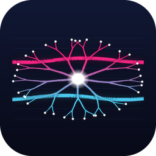

<p align="center"></p>

# ChATlas

**Retina connectome explorer** for CAVE / Neuroglancer datasets (built for `stroeh_mouse_retina`).
It places cells in **ChAT-normalised depth** (0 = OFF starburst band, 1 = ON band), using surfaces fitted to the labelled starburst amacrine cells around the region you look at.

## Install

ChATlas needs [Miniconda](https://docs.conda.io/en/latest/miniconda.html) (Miniforge or Anaconda also work). The installer creates a conda environment called `chatlas`.

Get the code: **Code → Download ZIP** on this page (then unzip), or `git clone https://github.com/jerjely/ChATlas.git`.

### Windows
Double-click **`install.bat`**. It adds **ChATlas** shortcuts to the desktop and Start menu.

### macOS (Apple Silicon and Intel)
Double-click **`install.command`**. If macOS says it is from an unidentified developer, right-click it → **Open**, or run it from Terminal:
```bash
cd path/to/ChATlas
bash install.command
```
It puts **ChATlas.app** in `~/Applications` (drag it to the Dock if you like).

### First start
Open **Settings**:
- **Open token page**, log in with the Google account you use in Neuroglancer, copy the token, paste it and click **Save token**. Then **Test connection**.
- Optional: point **mesh cache** to a folder of meshes you already downloaded, so nothing is downloaded twice. Click **Save settings**.

To update: download the new version and run the installer again. `uninstall.bat` / `uninstall.command` remove the environment and shortcuts; your data folder (`~/ChATlas`: settings, mesh cache, outputs) is kept.

## Synapse partners

For a cell annotated with **line annotations** in Neuroglancer (one end on the target cell, the other on a partner):

1. **Load Neuroglancer state…** – a `.txt`/`.json` file containing the JSON state (text before the first `{` is ignored, so a pasted email works).
2. **Analyse partners** – looks up the segment at both ends of every line (current root IDs), identifies the target cell, looks every partner up in the manual and machine cell-type tables, fits the ChAT surfaces from nearby SACs, measures the stratification of bipolar-like partners, and classifies unlabelled ones with a classifier trained on labelled bipolars nearby (cross-validated accuracy in the log).
3. **Partner types** – tick types to show/hide; hover any point or mesh for type and root ID. **Load partner meshes** adds the 3D partner cells for the ticked types.
4. **Distance** – **Pick origin** and click on the target cell where the primary dendrite leaves the soma (or type a Neuroglancer voxel). **Distance plots** shows distance per type, cumulative distributions, a map around the origin, depth vs distance, and polar plots per type; the log lists KS tests per type.
5. **Depth plots**, **Export tables** (partners, annotations with distances, classifier report, screenshot).

Clicking a table row copies the root ID and centres the view on that partner.

## Cell types

1. **Load cell-type tables**, choose label source (manual or manual+machine), class and type (any class: BC, AC, RGC, …).
2. Set the region: centre voxel (Neuroglancer x, y) or **Centre on cell** by root ID, and a radius.
3. **Show cells** – meshes of all cells of that type with soma in the region, optional ChAT surfaces and somata of all labelled cells nearby (hover for class/type/ID).
4. **Stratification & mosaic** – per-cell depth profiles, outlines at the main stratification depth (mosaic) and depth vs size; the table gains the measurements.

## Viewing in Neuroglancer

Every tab has an **Open in Neuroglancer** button. It builds a Neuroglancer state with the current selection (cells coloured as in ChATlas, synapse points / somata / search square as annotation layers), uploads it to the dataset's CAVE state server and opens the link in the browser (the link is also copied). Neuroglancer streams multi-resolution meshes, so it is the fastest way to look at many large cells; use ChATlas for selection and analysis.

## Notes

- Meshes are cached in the mesh cache folder; the first look at a region downloads them, later views are fast.
- Distances: choose **straight line in 3D** or **along the cell** in the Partners tab. Path distances use the target's L2 chunk graph (chunked-graph adjacency + L2-cache positions; Dijkstra from the origin), falling back to the mesh surface. Annotations on pieces not connected to the origin get no path distance.
- Partner direction (pre/post) is not encoded in line annotations.
- Data folder: `~/ChATlas` (Windows: `%USERPROFILE%\ChATlas`) — settings, mesh cache, outputs, `chatlas.log`.

## License

MIT — see [LICENSE](LICENSE). © 2026 Gergely Szarka, Szentágothai Research Centre, University of Pécs.
